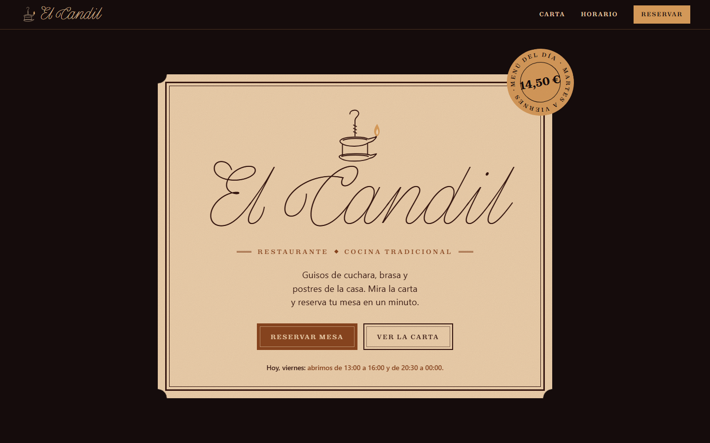
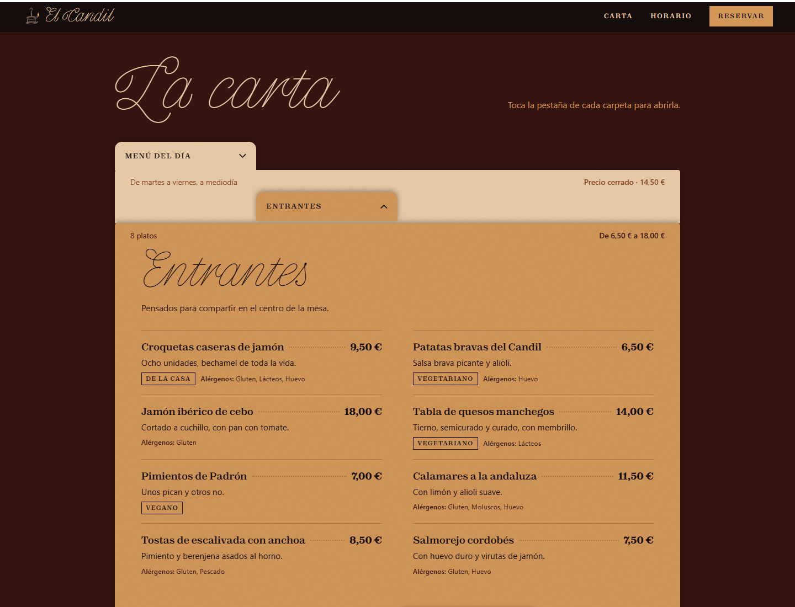

# 🕯️ El Candil

Web del restaurante El Candil: la carta en un archivador de carpetas y la reserva de mesa con control de aforo y comprobante por WhatsApp, en una sola página.


🔗 [Sitio en vivo](https://pauladolado.github.io/El-Candil/) (disponible en cuanto se active GitHub Pages, ver [Despliegue](#despliegue))



Página pública del restaurante. El comensal consulta la carta abriendo carpetas de un archivador, una por sección (menú del día, entrantes, otros primeros, carnes, pescados, postres, menú infantil y bebidas), con precios y alérgenos de cada plato. Después reserva mesa en un formulario que solo ofrece las horas con sitio, guarda la reserva respetando el aforo del local y, si el cliente lo pide, le envía el comprobante por WhatsApp desde el número del restaurante.

## Índice

- [Stack](#stack)
- [Arquitectura](#arquitectura)
- [Puesta en marcha](#puesta-en-marcha)
- [La carta: el archivador](#la-carta-el-archivador)
- [Reservas y aforo](#reservas-y-aforo)
- [Horario](#horario)
- [Editar los datos](#editar-los-datos)
- [Añadir una sección a la carta](#añadir-una-sección-a-la-carta)
- [Diseño](#diseño)
- [Accesibilidad](#accesibilidad)
- [Estructura del proyecto](#estructura-del-proyecto)
- [Despliegue](#despliegue)
- [Licencias](#licencias)

## Stack

| Capa | Tecnología |
| --- | --- |
| Lenguaje | HTML5, CSS y JavaScript sin módulos (funciona también abriendo el archivo con doble clic) |
| Build | Ninguno en la web: no hay `package.json`, dependencias ni paso de compilación |
| Estilos | Una sola hoja, `css/styles.css`, con la paleta en variables CSS |
| Tipografías | Pencerio (alojada en el propio proyecto), Zodiak y General Sans (API de Fontshare) |
| Iconos e ilustración | SVG propios dentro de `index.html` (el candil, flechas, teléfono, mapa) |
| Datos | Un único archivo, `js/data.js`, con la información del restaurante y la carta |
| Reservas | Supabase: PostgreSQL con funciones para el aforo y Row Level Security |
| Comprobante | Edge Function de Supabase (Deno) que llama a la API de WhatsApp Business (Cloud API) |
| Servidor local | `http-server` mediante `npx`, sin instalar nada en el proyecto |
| Hosting | Cualquier hosting estático; pensado para GitHub Pages |

## Arquitectura

```
js/data.js  ──►  js/app.js  ──►  index.html
 (datos)         (pinta y        (estructura fija:
                  gestiona)       portada, secciones, formulario)
```

- `index.html` contiene la estructura que no cambia: la portada en forma de etiqueta, los huecos de cada sección y el formulario de reserva.
- `js/data.js` define `window.EL_CANDIL` con la información del restaurante, los alérgenos y la carta.
- `js/app.js` lee esos datos y genera las carpetas de la carta, la línea de «hoy abrimos…» de la portada, la tabla de horario y las horas que se pueden reservar, y habla con Supabase para la reserva.
- `supabase/` contiene la base de datos de reservas y la función que envía el comprobante. Cómo ponerlo en marcha: [supabase/README.md](supabase/README.md).

```
Web ──► crear_reserva()      guarda la reserva si cabe en el aforo
    ──► disponibilidad()     marca las horas completas
    ──► enviar-comprobante   ──► API de WhatsApp Business ──► cliente
```

Sin Supabase configurado, la web sigue funcionando: «Reservar» envía la reserva al WhatsApp del restaurante, como al principio.

## Puesta en marcha

Requisito: Node.js (solo para el servidor local; la web no lo necesita).

```bash
npx --yes http-server@14.1.1 . -p 5173 -c-1
```

Abre http://localhost:5173. Al no tener paso de build, cualquier cambio en los archivos se ve recargando la página.

También se puede abrir `index.html` directamente en el navegador, aunque algunas fuentes externas pueden tardar más en cargar.

## La carta: el archivador

Cada sección de la carta es una carpeta con su pestaña. Las carpetas cerradas se solapan como en un cajón de archivo y muestran un resumen (número de platos y rango de precios). Al pulsar la pestaña, o la franja de la carpeta, esta se despliega y se cierra la que estuviera abierta.

- El menú del día empieza abierto.
- La medalla de la portada («Menú del día · 14,50 €») baja a la carta y abre esa carpeta.
- Se puede enlazar una carpeta concreta con `#carpeta-<id>`, por ejemplo `/#carpeta-postres`.
- Al abrir una carpeta, la página se desplaza para que su pestaña quede a la vista.

Hay tres tipos de sección:

| Tipo | Uso | Cómo se ve |
| --- | --- | --- |
| `platos` | Entrantes, otros primeros, carnes, pescados, postres | Lista a dos columnas con nombre, precio, descripción, etiquetas y alérgenos |
| `menu` | Menú del día, menú infantil | Precio cerrado, cuándo se sirve, qué incluye y las opciones de cada plato |
| `bebidas` | Bebidas | Grupos con una o varias columnas de precio (por ejemplo copa y botella) |

Cada plato puede llevar etiquetas (`veg`, `vegano`, `compartir`, `casa`) y su lista de alérgenos, que se muestra con el nombre completo de cada uno.

## Reservas y aforo

1. El comensal elige el día (de hoy a tres meses vista) y cuántos son.
2. Aparecen las horas de ese día, separadas en comida y cena, cada 30 minutos hasta la última hora de reserva. Las que ya no tienen sitio para ese número de personas salen tachadas como «Completo»; si se cambia el número de comensales, se recalculan.
3. Rellena nombre, teléfono y, si quiere, comentarios (alergias, trona, celebración…). El ticket de la derecha se va completando a la vez.
4. **Reservar mesa** comprueba cada campo y guarda la reserva. El servidor vuelve a mirar el aforo en ese instante: si alguien ha cogido las últimas plazas, avisa de cuántas quedan y propone otra hora.
5. Con la reserva guardada, el ticket se sella como «Confirmada», muestra el código de reserva (por ejemplo `K7M2QX`) y el formulario queda bloqueado para no duplicarla.
6. **Enviar comprobante por WhatsApp** se activa entonces. El cliente recibe, desde el WhatsApp del restaurante, un mensaje con su nombre, día, hora, comensales, código, dirección y el teléfono para cambios.
7. **Añadir al calendario** guarda la reserva como evento de dos horas con aviso dos horas antes: en iPhone y en el ordenador descarga un archivo `.ics` (Calendario de Apple, Outlook…); en Android abre Google Calendar con el evento ya relleno. También aparece sin Supabase, marcada como «por confirmar».
8. «Hacer otra reserva» deja el formulario limpio.

**Aforo:** cada reserva ocupa sus comensales durante el tiempo que dura una comida (120 minutos por defecto). Una reserva solo se acepta si, en ningún momento de ese tramo, la sala supera el aforo (60 por defecto). Los dos valores se cambian en la tabla `ajustes` de Supabase, sin tocar la web.

Los días de cierre muestran un aviso («Los lunes cerramos. Elige otro día.») y los grupos de más de 12 personas se derivan al teléfono.

## Horario

El horario de `js/data.js` alimenta tres sitios a la vez:

- la línea de la portada («Hoy, viernes: abrimos de 13:00 a 16:00 y de 20:30 a 00:00.» o «Hoy lunes cerramos. Volvemos mañana a las 13:00.»),
- la tabla de la sección «Visítanos», con el día de hoy marcado,
- las horas que se pueden reservar.

Cada turno se escribe como `[apertura, cierre, última reserva]`:

```js
horario: {
  0: { comida: ["13:00", "16:30", "15:30"] },        // domingo
  1: null,                                             // lunes: cerrado
  2: { comida: ["13:00", "16:00", "15:00"],
       cena:   ["20:30", "23:30", "22:30"] },          // martes
  // …
}
```

## Editar los datos

> [!IMPORTANT]
> Todo lo que hay ahora en `js/data.js` son **datos de ejemplo**. Cámbialos antes de publicar, sobre todo `whatsapp`, que es el número al que llegan las reservas.

| Campo | Qué es |
| --- | --- |
| `info.nombre`, `info.direccion`, `info.ciudad` | Nombre y dirección (también se usan en el enlace «Cómo llegar») |
| `info.telefono` | Teléfono que se muestra y se marca al pulsarlo |
| `info.whatsapp` | Número que recibe las reservas cuando no hay Supabase: prefijo de país y número, sin espacios ni `+` (por ejemplo `34600123456`) |
| `reservas.supabaseUrl`, `reservas.supabaseKey` | URL y clave pública del proyecto de Supabase; ver [supabase/README.md](supabase/README.md) |
| `info.horario` | Turnos por día de la semana (0 = domingo … 6 = sábado) |
| `info.maxComensales` | Máximo de personas por reserva online |
| `alergenos` | Nombres de los 14 alérgenos de declaración obligatoria |
| `carta` | Las secciones de la carta, en el orden en que aparecen las carpetas |

Los precios se escriben como números (`9.5`) y la web los muestra en formato español (`9,50 €`).

## Añadir una sección a la carta

Añade un objeto al array `carta` de `js/data.js`. La carpeta, su pestaña, su color y su resumen se generan solos.

```js
{
  id: "arroces",               // se usa en el enlace #carpeta-arroces
  titulo: "Arroces",
  tabCorta: "Arroces",         // opcional: texto de la pestaña en móvil
  tipo: "platos",              // "platos", "menu" o "bebidas"
  nota: "Mínimo dos personas.",
  grupos: [
    {
      platos: [
        { nombre: "Arroz con bogavante", desc: "Precio por persona.", precio: 24,
          alergenos: ["crustaceos"], etiquetas: ["compartir"] }
      ]
    }
  ]
}
```

Los colores de las carpetas se alternan solos (champagne, whiskey sour y honey garlic) y las pestañas se escalonan en cuatro posiciones, como en un archivador de verdad.

## Diseño

La web está pensada como una etiqueta de vermut o una chapa esmaltada de bar: filetes dobles, rótulos en mayúsculas espaciadas, una medalla con el precio del menú del día y el nombre en letra caligráfica.

**Paleta**

| Nombre | Hex | Uso |
| --- | --- | --- |
| Champagne | `#EACEAA` | Papel de la etiqueta, carpetas, campos del formulario |
| Honey Garlic | `#85431E` | Botón principal, carpetas, detalles |
| Whiskey Sour | `#D39858` | Fondo de la reserva, carpetas, medalla |
| Burnt Coffee | `#34150F` | Tinta de la etiqueta, fondo de la carta |
| Balsámico | `#150C0C` | Fondo general, cabecera y pie |

**Tipografía**

| Fuente | Uso |
| --- | --- |
| Pencerio | Nombre del restaurante y títulos grandes («La carta», «Reserva tu mesa»…) |
| Zodiak | Rótulos, pestañas, nombres de plato y precios |
| General Sans | Textos, descripciones y formulario |

Pencerio solo tiene un peso muy fino, así que se usa siempre a tamaño grande.

## Accesibilidad

- Cada pestaña es un botón con `aria-expanded` y `aria-controls`; el contenido de cada carpeta es una región con nombre.
- Todo se puede usar con teclado, con foco visible en el color de la paleta.
- Enlace «Saltar a la carta» al principio de la página.
- Los errores del formulario están asociados a su campo con `aria-describedby` y `aria-invalid`, y el resultado del envío se anuncia con `role="status"`.
- Los precios de bebidas con varias columnas llevan la etiqueta («Copa», «Botella») para lectores de pantalla.
- Contraste de texto revisado sobre cada fondo de la paleta.
- Con `prefers-reduced-motion` se desactivan la llama del candil, el despliegue animado y el desplazamiento suave.
- Alérgenos escritos con su nombre completo, no con iconos.

## Estructura del proyecto

```
El-Candil/
├── index.html            Estructura de la página e iconos SVG
├── css/
│   └── styles.css        Estilos, paleta y adaptación a móvil
├── js/
│   ├── data.js           Datos del restaurante y la carta (editar aquí)
│   └── app.js            Carta, horario y formulario de reserva
├── fonts/
│   ├── Pencerio-Hairline.woff2
│   ├── Pencerio-Hairline.woff
│   └── Pencerio-LICENSE.txt
├── img/
│   └── favicon.svg
├── supabase/
│   ├── migrations/       Tablas de reservas y ajustes, funciones de aforo
│   ├── functions/
│   │   └── enviar-comprobante/   Envío del comprobante por WhatsApp
│   └── README.md         Puesta en marcha de las reservas online
├── docs/                 Capturas para este README
├── PRODUCT.md            Contexto del producto (público, objetivos, restricciones)
└── README.md
```

## Despliegue

Al ser una web estática, se publica tal cual.

**GitHub Pages**

1. En el repositorio, ve a **Settings → Pages**.
2. En **Source**, elige **Deploy from a branch**, rama `main` y carpeta `/ (root)`.
3. Guarda. En uno o dos minutos la web estará en https://pauladolado.github.io/El-Candil/.

Cada push a `main` vuelve a publicarla.

**Otros hostings** (Netlify, Vercel, un servidor propio…): sube la carpeta completa; no hace falta configurar ningún comando de build.



## Licencias

- Pencerio es de Indian Type Foundry y se distribuye con la ITF Free Font License; el texto está en [`fonts/Pencerio-LICENSE.txt`](fonts/Pencerio-LICENSE.txt).
- Zodiak y General Sans se cargan desde la API de Fontshare con la misma licencia.
